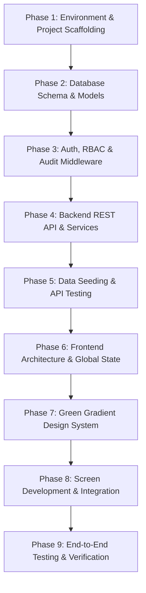

# Ward Management System — Comprehensive End-to-End Implementation Plan

**Project:** Ward Management System (React + Node.js + Express + MongoDB)  
**Document Type:** Step-by-Step From-Scratch Development & Implementation Guide  
**Date:** October 29, 2026  
**Architecture:** Monorepo (`client/` and `server/`)  

---

## 1. Overview & Core Philosophy

This document outlines the complete architectural roadmap and implementation order used to build the **Ward Management System** from scratch. The application follows a strict **privacy-first administrative model**:
- **Zero Profiling**: Religious preference and political party affiliation are strictly excluded from voter targeting profiles or automated messaging lists.
- **Strict Data Scoping**: All dashboards, queries, and reports are dynamically scoped to authorized wards.
- **Atomic Operations**: Families and multiple member rows are validated and committed in unified transactions/workflows.



---

## 2. Phase-by-Phase Development Order

### Phase 1: Environment Setup & Project Scaffolding
1. **Initialize Project Root**:
   - Create monorepo folders: `server/` and `client/`.
   - Setup root `.gitignore` to prevent committing `node_modules`, `.env`, and build outputs.
2. **Server Initialization**:
   - `npm init -y` inside `server/`.
   - Install production dependencies: `express`, `mongoose`, `dotenv`, `cors`, `helmet`, `morgan`, `jsonwebtoken`, `bcryptjs`, `zod`.
   - Install development dependencies: `nodemon`.
   - Setup `server/.env` and `server/.env.example` templates.
3. **Client Initialization**:
   - Scaffold Vite React app: `npm create vite@latest client -- --template react`.
   - Install dependencies: `react-router-dom`, `axios`, `lucide-react`, `clsx`, `tailwind-merge`.
   - Install Tailwind CSS: `@tailwindcss/vite`, `tailwindcss`.
   - Configure `/api` reverse proxy in `client/vite.config.js` pointing to `http://localhost:5000`.

---

### Phase 2: MongoDB Schemas & Data Modeling
Build robust Mongoose models with proper indexes, unique constraints, and ObjectId references:

1. **`User` Model (`server/src/models/User.js`)**:
   - Fields: `username`, `password` (bcrypt hashed), `fullName`, `email`, `role` (`superadmin`, `ward_officer`, `data_operator`, `auditor`), `assignedWards` (`[ObjectId]`), `isActive`.
2. **`Ward` Model (`server/src/models/Ward.js`)**:
   - Fields: `wardCode` (unique index), `wardName`, `locality`, `district`, `zone`, `totalPopulationEstimate`, `isArchived`.
3. **`Family` Model (`server/src/models/Family.js`)**:
   - Fields: `familyCode` (unique index), `wardId` (indexed reference), `headOfFamilyName`, `familyLabel`, `houseNo`, `street`, `locality`, `contactPhone`, `status` (`complete` / `incomplete`), `memberCount`, `isArchived`.
4. **`Member` Model (`server/src/models/Member.js`)**:
   - Fields: `memberCode` (unique index), `familyId` (indexed reference), `wardId` (indexed reference), `fullName`, `gender`, `age`, `dateOfBirth`, `relationship`, `isVoterEligible` (auto-calculated for age >= 18), `partyId` (optional), `status`.
5. **`Party` Model (`server/src/models/Party.js`)**:
   - Fields: `partyCode` (unique), `partyName`, `symbol`, `abbreviation`, `color`, `isActive`, `isArchived`.
6. **`AuditLog` Model (`server/src/models/AuditLog.js`)**:
   - Fields: `userId`, `username`, `action` (`CREATE`, `UPDATE`, `ARCHIVE`, `LOGIN`, `EXPORT`), `entityType`, `entityId`, `wardId`, `ipAddress`, `userAgent`, `details`.

---

### Phase 3: Security, Authentication & Audit Infrastructure
1. **JWT Authentication Middleware (`server/src/middleware/auth.js`)**:
   - `protect`: Extracts and verifies JWT bearer token from headers. Attaches active user to `req.user`.
   - `authorize(...roles)`: Verifies if user role has access to specific endpoints.
   - `verifyWardAccess`: Ensures field operators can only access or mutate records in their assigned wards (`req.user.assignedWards`).
2. **Audit Logging Service (`server/src/services/auditService.js`)**:
   - Centralized `logAudit()` utility that records immutable audit logs for administrative actions asynchronously.

---

### Phase 4: Express REST API Controllers & Routes
Build modular controllers with Zod schema validation:

1. **Auth Routes (`/api/auth`)**:
   - `POST /login`: Validates credentials, issues JWT token.
   - `GET /me`: Returns current logged-in user profile.
   - `GET /users` & `POST /users`: Role-based operator management.
2. **Ward Routes (`/api/wards`)**:
   - `GET /`: Lists all authorized wards (supports search & archive filtering).
   - `POST /`: Creates new ward with unique uppercase code.
   - `PATCH /:id`: Updates ward metadata.
   - `PATCH /:id/archive`: Toggles soft-archive status.
3. **Family Routes (`/api/families`)**:
   - `GET /`: Lists families scoped to ward with pagination, search, and status filters.
   - `POST /`: **Atomic family creation** — creates `Family` and dynamically inserts child `Member` documents in one safe request.
   - `GET /:id`: Fetches family and all linked active members.
   - `PATCH /:id/archive`: Cascading soft-archive for family and all its members.
4. **Member Routes (`/api/members`)**:
   - `GET /`: Lists members with filters (age categories, voter eligibility 18+, gender, party).
   - `POST /`: Adds single member to an existing family (auto-increments `family.memberCount`).
   - `PATCH /:id`: Updates member attributes and recalculates voter eligibility.
5. **Dashboard & Summary Routes (`/api/dashboard`)**:
   - `GET /summary?wardId=...`: Runs multi-stage MongoDB aggregation pipelines to calculate:
     - Total families & completion rate breakdown.
     - Total members, eligible voters (18+), and minors.
     - Locality concentration statistics.
     - Recent administrative audit logs.
6. **Reports & Exports (`/api/reports`)**:
   - `GET /ward/:id`: Detailed statistical demographic breakdown.
   - `GET /ward/:id/export-csv`: Generates and streams authorized CSV file downloads.
   - `GET /audit-logs`: Audit trail browser for compliance auditors.

---

### Phase 5: Database Seeder & API Verification
1. **Seeder Script (`server/src/scripts/seed.js`)**:
   - Connects to MongoDB, clears test collections.
   - Creates administrative accounts (`admin` superadmin, `operator` field operator).
   - Creates 4 sample wards (`WARD-01` to `WARD-04`).
   - Seeds realistic multi-member families with complete and incomplete records.
2. **API Verification**:
   - Test endpoints with PowerShell/Postman:
     - Health check: `GET /api/health` -> 200 OK.
     - Auth: `POST /api/auth/login` -> Bearer token.
     - Aggregations: `GET /api/dashboard/summary?wardId=...` -> JSON KPI metrics.

---

### Phase 6: Frontend Architecture & Global State
1. **API Service Layer (`client/src/services/api.js`)**:
   - Axios instance with base URL `/api`.
   - Request interceptor attaching `Authorization: Bearer <token>`.
   - Response interceptor catching `401` to clear local storage and redirect to `/login`.
2. **Global Auth & Ward Context (`client/src/context/AuthContext.jsx`)**:
   - Manages `user`, `token`, `wards`, and `selectedWard`.
   - Automatically synchronizes `selectedWard` across all child pages so switching wards in the header immediately updates the entire interface.
3. **Routing & Protected Layout (`client/src/App.jsx` & `client/src/layouts/Layout.jsx`)**:
   - Layout with fixed responsive `Sidebar` and top `Navbar`.
   - `ProtectedRoute` component enforcing role authorization (`superadmin`, `ward_officer`, `data_operator`, `auditor`).

---

### Phase 7: Centralized Theme System (Gradient Green / Emerald)
1. **Theme Tokens (`client/src/theme/theme.js`)**:
   - Centralizes colors (Emerald 500/600/700, Teal, Mint), gradient presets, button variants, and badge tokens.
2. **CSS Variables (`client/src/index.css`)**:
   - Adds custom glowing shadows (`.gradient-green-glow`), text gradients, and themed scrollbars.
3. **Reusable Component Suite (`client/src/components/common/`)**:
   - `ThemeButton.jsx`: Standardized gradient CTA buttons with active animations.
   - `ThemeCard.jsx`: Glassmorphic cards with gradient top borders.
   - `ThemeBadge.jsx`: Uniform status and ward indicator pills.
   - `ThemeStatCard.jsx`: Dashboard KPI cards with icon backgrounds and percentage badges.

---

### Phase 8: Screen Development & Integration
1. **`Login.jsx`**:
   - Dark aesthetic with ambient green radial glow, demo accounts helper, and secure sign-in.
2. **`Dashboard.jsx`**:
   - Hero banner displaying currently selected ward details.
   - 4 `ThemeStatCard` components (Total Families, Total Residents, Completed Registrations, Incomplete Follow-ups).
   - Locality & Sector density progress table.
   - Demographic distribution breakdown (Male, Female, Other, 18+ voters).
   - Recent activity stream populated from live audit logs.
3. **`Families.jsx` & `FamilyForm.jsx`**:
   - Searchable, paginated family list with status filter.
   - Dynamic registration form: Section A (Household Address) & Section B (Dynamic multi-member rows).
   - "Save Family & Close" validation that submits payload atomically.
4. **`FamilyDetails.jsx`**:
   - Household overview card and full member directory with "Add Member" modal.
5. **`Members.jsx`**:
   - Master resident index with search, age filter (18+ voters vs minors), gender filter, and political party filter.
6. **`Parties.jsx`**:
   - Political party management for authorized administrative reference.
7. **`Reports.jsx`**:
   - Formal statutory reports with one-click CSV export stream.
8. **`UsersPage.jsx` & `AuditLogs.jsx`**:
   - Superadmin operator provisioning and security audit trail viewer.

---

### Phase 9: Testing, Quality Assurance & Verification
1. **Build Validation**:
   - Run `npx vite build` to ensure zero compilation or type errors.
2. **Workflow Test (The Golden Path)**:
   - Login as `admin`.
   - Select `WARD-01` from the top navigation dropdown.
   - Navigate to "Register New Family".
   - Enter family details and add 2 members (1 adult head, 1 child).
   - Click "Save Family & Close".
   - Verify redirection to Family Directory and confirm family appears.
   - Open Dashboard and verify:
     - Families count increased by 1.
     - Members count increased by 2.
     - Adult eligible voter count increased by 1.
   - Test CSV export from Reports page and verify file download.

---

## 3. Recommended Production Runbook

To start the system in local development:

```powershell
# 1. Start MongoDB Service (Windows)
Start-Service MongoDB

# 2. Start Backend Server
cd "d:\MWT\voter management\server"
npm run dev

# 3. Start Frontend Client (in a separate terminal)
cd "d:\MWT\voter management\client"
npm run dev
```

Visit **`http://localhost:5173`** and log in with:
- **Username:** `admin` | **Password:** `admin123`
- Or **Username:** `operator` | **Password:** `admin123`
